# Bank Loan Credit Risk & Portfolio Performance Analysis

An end-to-end consumer credit risk and underwriting portfolio analysis across **38,576 loan originations** representing **$435.76M in funded principal** and **$473.07M in cumulative repayments**. This project establishes an automated SQL validation framework to track Month-to-Date (MTD) and Month-over-Month (MoM) lending velocity, borrower Debt-to-Income (DTI) leverage, interest rate spread, and default loss severity across performing versus charged-off cohorts.

---

## Executive Summary & Portfolio Risk Impact

| Portfolio Metric | Full Portfolio | Performing ("Good") Loans | Charged-Off ("Bad") Loans |
| :--- | :---: | :---: | :---: |
| **Loan Application Volume** | 38,576 (100.0%) | **33,243 (86.18%)** | **5,333 (13.82%)** |
| **Total Funded Principal** | $435.76M | **$370.22M** | **$65.53M** |
| **Total Repayments Received** | $473.07M | **$435.79M** | **$37.28M** |
| **Net Cash Spread / Principal Loss** | +$37.31M Net | **+$65.57M Spread** | **-$28.25M Loss (43.1% Severity)** |
| **Average Interest Rate / DTI** | 12.05% / 13.33% | 11.62% / 13.15% | 14.73% / 14.42% |

### Key Underwriting & Risk Findings
* **Default Loss Severity:** While **86.18%** of the portfolio performs on schedule (`Fully Paid` and `Current`), generating **$65.57M** in gross interest income above principal, the **13.82%** `Charged Off` cohort recovered only **$37.28M** against **$65.53M** funded—resulting in a **43.1% principal loss rate**.
* **DTI & Sub-Grade Risk Concentration:** Defaulted borrowers exhibit elevated average Debt-to-Income ratios (**14.42%**) alongside higher coupon tiers (**14.73%**). Enforcing stricter DTI caps (`<25%`) on high-risk debt-consolidation sub-grades mitigates tail credit losses.
* **Origination & Repayment Momentum:** December MTD volume reached **4,314 applications** (**$53.98M funded** and **$58.07M collected**), reflecting strong year-end cash collection velocity.

---

## 1. Origination Velocity & Cash Inflow KPIs (SQL)

### 1.1 Total & Month-to-Date (MTD) Loan Applications
<pre><code>SELECT 
    COUNT(id) AS total_loan_applications,
    COUNT(
        CASE WHEN MONTH(issue_date) = 12 AND YEAR(issue_date) = 2021 
        THEN id END
    ) AS mtd_loan_applications
FROM bank_loan_data;</code></pre>

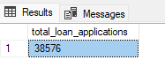
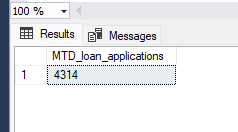

### 1.2 Month-to-Date (MTD) Total Funded Principal
<pre><code>SELECT 
    SUM(loan_amount) AS mtd_total_funded_amount
FROM bank_loan_data
WHERE MONTH(issue_date) = 12 
  AND YEAR(issue_date) = 2021;</code></pre>

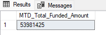

### 1.3 Month-over-Month (MoM) Repayment & Cash Collection Trend
Uses `LAG()` window functions to measure monthly repayment momentum across the 2021 origination cohort:
<pre><code>WITH monthly_collections AS (
    SELECT 
        YEAR(issue_date) AS issue_year,
        MONTH(issue_date) AS issue_month,
        SUM(total_payment) AS monthly_amount_received
    FROM bank_loan_data
    WHERE YEAR(issue_date) = 2021
    GROUP BY YEAR(issue_date), MONTH(issue_date)
)
SELECT 
    issue_year,
    issue_month,
    monthly_amount_received AS current_month_received,
    LAG(monthly_amount_received) OVER (
        ORDER BY issue_year, issue_month
    ) AS previous_month_received,
    monthly_amount_received - LAG(monthly_amount_received) OVER (
        ORDER BY issue_year, issue_month
    ) AS mom_collection_delta
FROM monthly_collections
ORDER BY issue_year, issue_month;</code></pre>

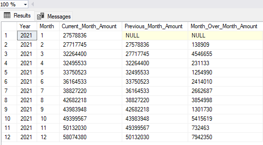

---

## 2. Pricing Spread & Borrower Leverage (DTI)

### 2.1 Annual & Month-over-Month Average Interest Rate
<pre><code>WITH monthly_rates AS (
    SELECT
        YEAR(issue_date) AS issue_year,
        MONTH(issue_date) AS issue_month,
        ROUND(AVG(int_rate) * 100, 2) AS avg_interest_rate_pct
    FROM bank_loan_data
    WHERE YEAR(issue_date) = 2021
    GROUP BY YEAR(issue_date), MONTH(issue_date)
)
SELECT
    issue_year,
    issue_month,
    avg_interest_rate_pct AS current_month_rate,
    LAG(avg_interest_rate_pct) OVER (
        ORDER BY issue_year, issue_month
    ) AS previous_month_rate,
    ROUND(
        avg_interest_rate_pct - LAG(avg_interest_rate_pct) OVER (
            ORDER BY issue_year, issue_month
        ), 2
    ) AS mom_rate_delta
FROM monthly_rates
ORDER BY issue_year, issue_month;</code></pre>

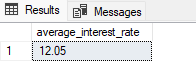
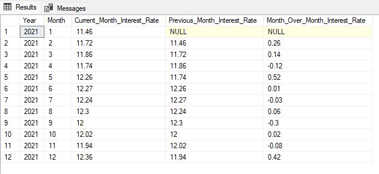

### 2.2 Portfolio Debt-to-Income (DTI) Exposure
<pre><code>SELECT
    ROUND(AVG(int_rate) * 100, 2) AS portfolio_avg_interest_rate_pct,
    ROUND(AVG(dti) * 100, 2) AS portfolio_avg_dti_pct
FROM bank_loan_data;</code></pre>

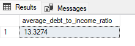

---

## 3. Credit Risk Segmentation: Performing vs. Charged-Off Cohorts

### 3.1 Performing ("Good") Loan Portfolio (`Fully Paid` & `Current`)
<pre><code>SELECT
    ROUND(
        COUNT(CASE WHEN loan_status IN ('Fully Paid', 'Current') THEN id END) * 100.0 
        / COUNT(id), 2
    ) AS good_loan_pct,
    COUNT(
        CASE WHEN loan_status IN ('Fully Paid', 'Current') THEN id END
    ) AS good_loan_applications,
    CONCAT(
        CAST(SUM(CASE WHEN loan_status IN ('Fully Paid', 'Current') THEN loan_amount END) / 1000000.0 AS DECIMAL(18,2)),
        'M'
    ) AS good_loan_funded_millions,
    CONCAT(
        CAST(SUM(CASE WHEN loan_status IN ('Fully Paid', 'Current') THEN total_payment END) / 1000000.0 AS DECIMAL(18,2)),
        'M'
    ) AS good_loan_received_millions
FROM bank_loan_data;</code></pre>

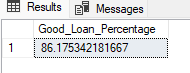
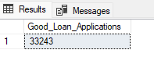
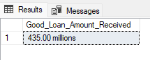

### 3.2 Charged-Off ("Bad") Loan Loss Analysis (`Charged Off`)
<pre><code>SELECT
    ROUND(
        COUNT(CASE WHEN loan_status = 'Charged Off' THEN id END) * 100.0 
        / COUNT(id), 2
    ) AS bad_loan_pct,
    COUNT(
        CASE WHEN loan_status = 'Charged Off' THEN id END
    ) AS bad_loan_applications,
    CONCAT(
        CAST(SUM(CASE WHEN loan_status = 'Charged Off' THEN loan_amount END) / 1000000.0 AS DECIMAL(18,2)),
        'M'
    ) AS bad_loan_funded_millions,
    CONCAT(
        CAST(SUM(CASE WHEN loan_status = 'Charged Off' THEN total_payment END) / 1000000.0 AS DECIMAL(18,2)),
        'M'
    ) AS bad_loan_recovered_millions
FROM bank_loan_data;</code></pre>

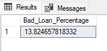
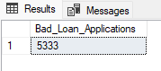
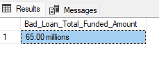
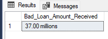

